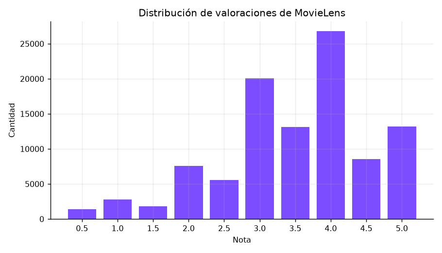
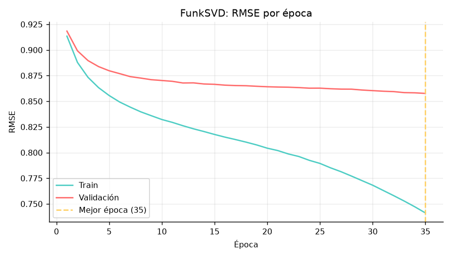
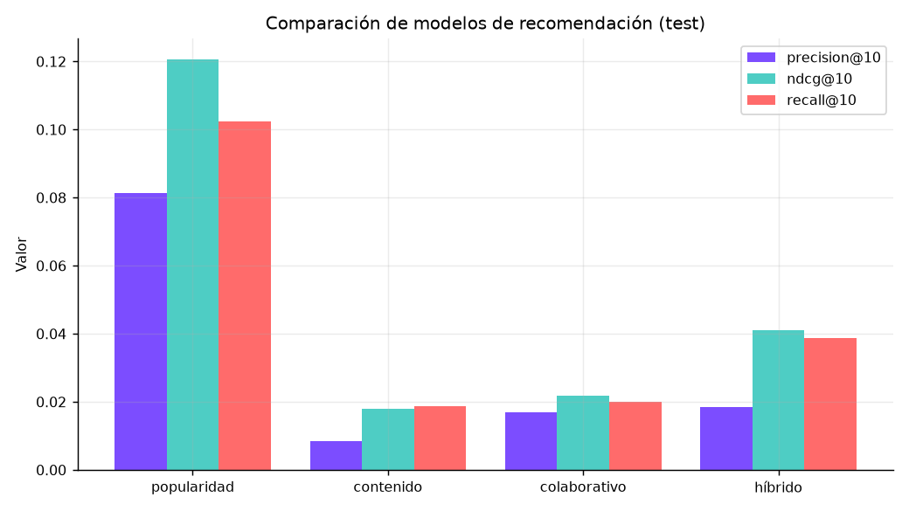
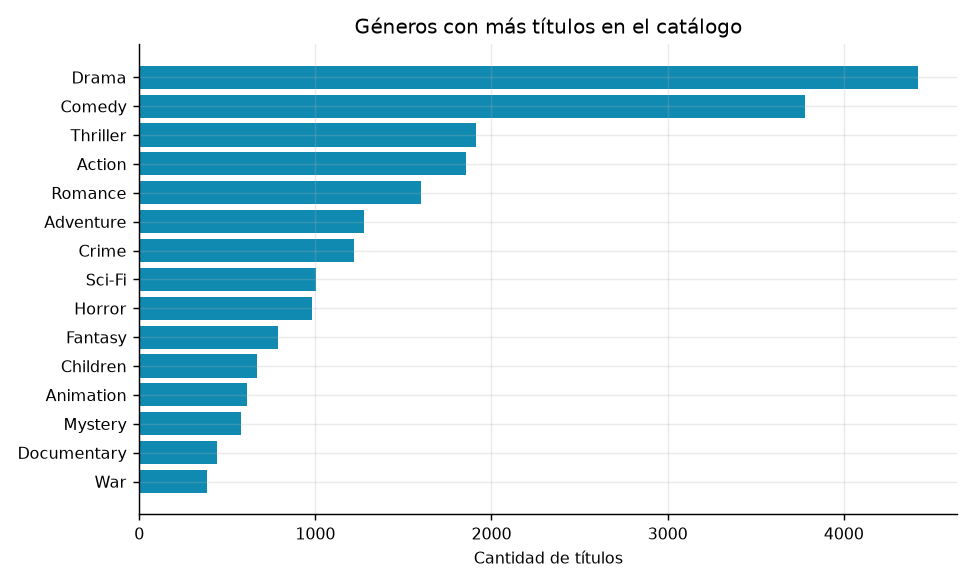
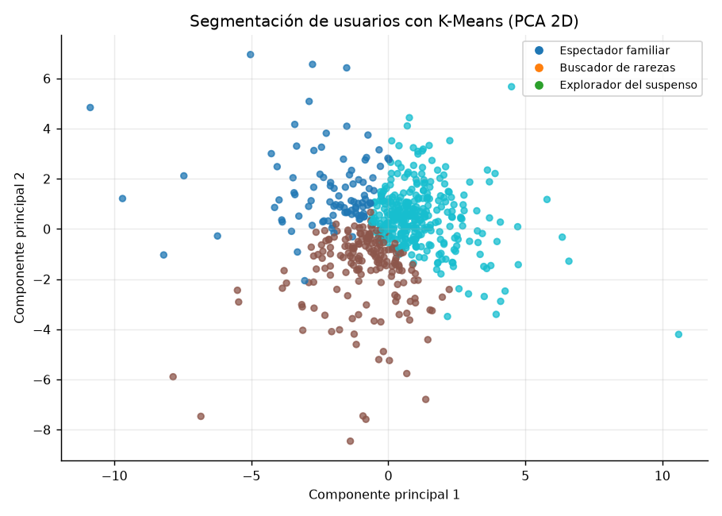
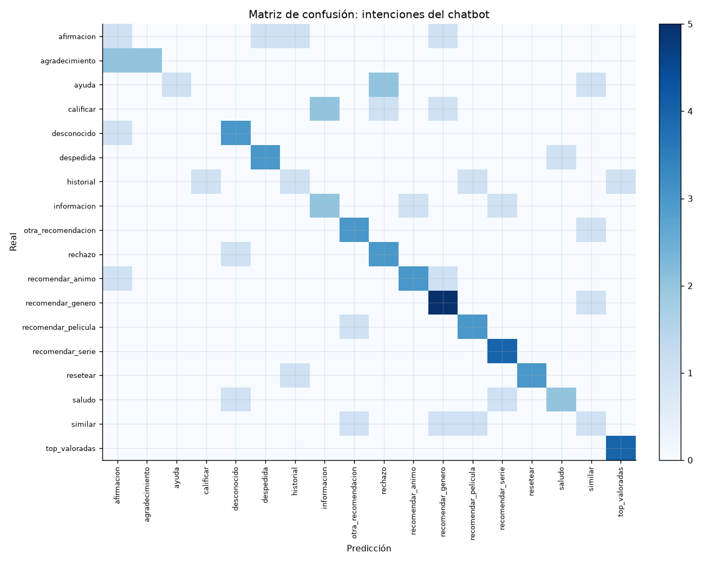
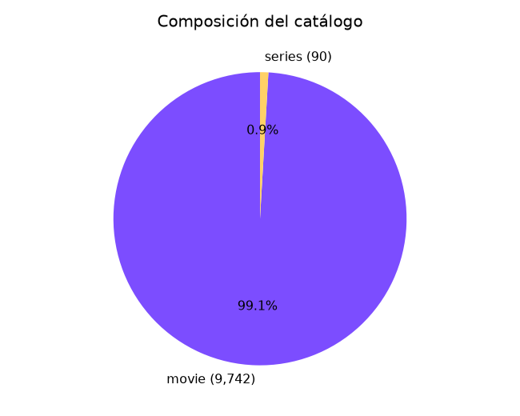

# Evaluación de modelos — CineBot

Generado: 2026-10-25 13:59:32 UTC

## 1. Datos

- Ítems del catálogo: **9,832** (9,742 películas y 90 series).
- Valoraciones MovieLens: **100,836** de 610 usuarios.
- Partición: train=70,614, validación=15,111, test=15,111.

## 2. Predicción de notas

| Métrica | Valor |
|---|---|
| RMSE baseline (media global) | 1.0355 |
| RMSE FunkSVD | 0.8503 |
| MAE FunkSVD | 0.6508 |
| R² FunkSVD | 0.3181 |
| Mejora de RMSE vs baseline | 17.88% |
| Factores latentes | 24 |
| Mejor época | 35 |
| Valoraciones de test evaluadas | 14,433 |

## 3. Ranking top-10 (test)

| Métrica | Valor |
|---|---|
| Usuarios evaluados | 588 |
| Precision@10 popularidad (baseline) | 0.0813 |
| Precision@10 contenido | 0.0083 |
| Precision@10 colaborativo | 0.0170 |
| Precision@10 híbrido | 0.0184 |
| Recall@10 híbrido | 0.0386 |
| NDCG@10 híbrido | 0.0411 |
| Hit Rate@10 híbrido | 0.1616 |
| Cobertura del catálogo | 8.75% |
| Diversidad media (Jaccard) | 0.5815 |

Pesos elegidos por validación: contenido=0.40, colaborativo=0.30, calidad=0.20, popularidad=0.10.

## 4. Clasificador de intenciones

| Métrica | Valor |
|---|---|
| Accuracy | 0.5867 |
| F1 macro | 0.5625 |
| F1 ponderado | 0.5667 |
| Validación cruzada (media) | 0.5764 ± 0.0941 |
| Ejemplos etiquetados | 373 |
| Intenciones | 18 |

## 5. Segmentación K-Means

| Métrica | Valor |
|---|---|
| K elegido | 3 |
| Silueta | 0.1253 |
| Usuarios agrupados | 610 |
| Varianza explicada por PCA | 36.7% |

## 6. Figuras

### Ratings Distribution

### Svd Learning Curve

### Model Comparison

### Genre Distribution

### User Clusters

### Intent Confusion

### Catalog Composition

## 7. Búsqueda de pesos del híbrido

| Contenido | Colaborativo | Calidad | Popularidad | NDCG@10 | Precision@10 |
|---|---|---|---|---|---|
| 0.50 | 0.30 | 0.15 | 0.05 | 0.0180 | 0.0108 |
| 0.45 | 0.35 | 0.15 | 0.05 | 0.0185 | 0.0125 |
| 0.40 | 0.40 | 0.15 | 0.05 | 0.0209 | 0.0142 |
| 0.35 | 0.45 | 0.15 | 0.05 | 0.0200 | 0.0125 |
| 0.55 | 0.25 | 0.15 | 0.05 | 0.0174 | 0.0100 |
| 0.50 | 0.40 | 0.10 | 0.00 | 0.0164 | 0.0108 |
| 0.40 | 0.50 | 0.10 | 0.00 | 0.0156 | 0.0100 |
| 0.60 | 0.20 | 0.15 | 0.05 | 0.0154 | 0.0083 |
| 0.45 | 0.30 | 0.20 | 0.05 | 0.0178 | 0.0117 |
| 0.35 | 0.35 | 0.25 | 0.05 | 0.0212 | 0.0142 |
| 0.50 | 0.30 | 0.10 | 0.10 | 0.0199 | 0.0125 |
| 0.40 | 0.30 | 0.20 | 0.10 | 0.0249 | 0.0158 |
